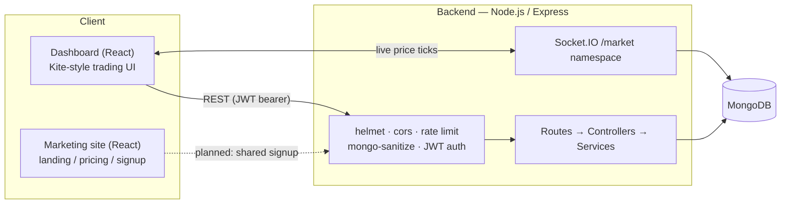

# Zerodha Clone — Full-Stack Trading Platform

A full-stack, MERN-based simulation of Zerodha's Kite trading terminal: JWT-authenticated
accounts, a real order-execution engine (funds/holdings checks, atomic wallet + portfolio
updates), and a live market-data feed pushed to every connected client over WebSockets.

This started from a static UI-cloning tutorial (see [`git log`](#project-history) for the
original commits) and has been rebuilt into a project structured the way a production
service would be: layered backend architecture, JWT auth, an order engine with real
business rules, automated tests, CI, and containerized deployment.

---

## Table of contents

- [Why this project exists](#why-this-project-exists)
- [Architecture](#architecture)
- [Tech stack](#tech-stack)
- [What changed from the original tutorial clone](#what-changed-from-the-original-tutorial-clone)
- [Repository structure](#repository-structure)
- [Getting started](#getting-started)
- [API reference](#api-reference)
- [Testing](#testing)
- [CI/CD](#cicd)
- [Environment variables](#environment-variables)
- [Known limitations & roadmap](#known-limitations--roadmap)
- [Project history](#project-history)

---

## Why this project exists

Most "Zerodha clone" tutorials stop at a pixel-accurate UI wired to two unauthenticated
routes (`GET /allHoldings`, `POST /newOrder`) that write whatever the client sends
straight into MongoDB — no auth, no funds check, no effect on a portfolio, one shared
dataset for every visitor. That's fine for learning React, but it isn't a system.

This repo takes the same UI and turns it into an actual trading platform backend:
an order can be **rejected** (insufficient funds, insufficient holdings), every order
is **audited** (including rejections), a user's cash and holdings are **derived, not
duplicated**, and every write that touches money is **isolated per authenticated user**.

## Architecture



**Request flow for a trade:** `Route` validates the payload (`express-validator`) →
`Controller` extracts the request → `orderService.placeOrder` runs the business logic
(funds/holdings check, wallet debit/credit, holding upsert, audit record) inside a
MongoDB transaction → a uniform `{ success, data }` / `{ success, error }` envelope goes
back to the client. See [`backend/src/services/orderService.js`](backend/src/services/orderService.js).

## Tech stack

| Layer            | Choices |
|-------------------|---------|
| Frontend (app)    | React 18, React Router 6, MUI, Chart.js, Axios, Socket.IO client |
| Frontend (marketing) | React 18, React Router — static Zerodha-style landing/pricing pages |
| Backend           | Node.js, Express, Mongoose (MongoDB), Socket.IO |
| Auth              | JWT (`jsonwebtoken`), `bcryptjs` password hashing |
| Validation        | `express-validator` |
| Security          | `helmet`, `express-rate-limit`, `express-mongo-sanitize`, CORS allow-list |
| Observability     | `winston` structured logging, `morgan` HTTP access logs |
| API docs          | OpenAPI 3 via `swagger-jsdoc` + `swagger-ui-express`, served at `/api-docs` |
| Testing           | Jest, Supertest, `mongodb-memory-server` (no external DB needed to run tests) |
| CI/CD             | GitHub Actions — lint + test + coverage on every push/PR |
| Containerization  | Docker + Docker Compose (Mongo + API + dashboard, one command) |

## What changed from the original tutorial clone

| Area | Before | After |
|---|---|---|
| Auth | None — one shared dataset for everyone | JWT signup/login, `bcryptjs` password hashing, every route scoped to `req.user` |
| Orders | `POST /newOrder` wrote the client's payload straight to Mongo, unconditionally | `orderService.placeOrder` checks funds/holdings, debits/credits the wallet, upserts the holding, and **persists rejected orders too** — a real audit trail, inside a Mongo transaction (with a documented standalone-node fallback) |
| Data model | Holdings stored a denormalized `price`/`net`/`day` on every row | Holdings/positions store only `qty` + weighted-avg cost; live price is looked up from a shared `Instrument` feed and P&L is computed, so it can't drift out of sync |
| Market data | A hardcoded array in `dashboard/src/data/data.js` | A real `Instrument` collection, perturbed by a simulated tick service and streamed to clients over a Socket.IO `/market` namespace |
| API surface | Two unversioned, unauthenticated routes on the root path | Versioned `/api/*` REST resources, documented with OpenAPI/Swagger, with the old routes returning a clear "moved" error instead of a silent 404 |
| Errors | Unhandled promise rejections, inconsistent responses | Central `errorHandler` translating Mongoose/JS errors into a consistent `{ success, error }` shape; `asyncHandler` wrapper so no route can crash the process |
| Security | None (no rate limiting, no input sanitization, permissive CORS) | `helmet`, origin allow-list, `express-rate-limit` (tighter on `/auth`), NoSQL-injection sanitization, request size limits |
| Tests | None | 12 Jest/Supertest tests covering signup/login/auth guards and the BUY/SELL execution + rejection paths, run against an in-memory Mongo instance |
| Ops | `nodemon index.js`, no Docker, no CI | Dockerfiles for both apps, a root `docker-compose.yml` for the full stack, GitHub Actions CI, structured logging, a `/api/health` check |
| Frontend data | Three components with `axios.get("http://localhost:3002/...")` hardcoded inline, no auth, no error handling | A single configured Axios client (JWT interceptor + auto-logout on 401), a `PortfolioContext` shared across screens, and a live-price hook backing the watchlist |

## Repository structure

```
zerodha-clone/
├── backend/                  # REST API + WebSocket price feed
│   ├── server.js             # HTTP server bootstrap, graceful shutdown, Socket.IO wiring
│   ├── src/
│   │   ├── app.js            # Express app: middleware, routes, error handling
│   │   ├── config/           # env validation, DB connection, logger, Swagger spec
│   │   ├── routes/           # Express routers (+ OpenAPI JSDoc annotations)
│   │   ├── controllers/      # thin HTTP-layer handlers
│   │   ├── services/         # business logic (order execution, auth, market data)
│   │   ├── models/           # Mongoose schemas (User, Wallet, Holding, Position, Order, Instrument)
│   │   ├── middleware/       # auth, rate limiting, validation, error handling
│   │   └── sockets/          # live price-tick broadcaster
│   ├── scripts/seed.js       # demo user + instruments + starter portfolio
│   └── tests/                # Jest + Supertest, run against mongodb-memory-server
├── dashboard/                 # The Kite-style trading app (this is the "product")
│   └── src/
│       ├── api/               # Axios client + Socket.IO client
│       ├── auth/               # localStorage session helpers
│       ├── context/            # PortfolioContext (holdings/positions/orders/wallet/instruments)
│       ├── hooks/               # useMarketSocket — live price ticks
│       └── components/         # Login/Signup, Dashboard, Holdings, Positions, Funds, Orders, WatchList...
├── frontend/                  # Zerodha-style marketing site (landing, pricing, about)
├── docker-compose.yml         # Mongo + backend + dashboard, one command
└── .github/workflows/ci.yml   # lint + test + build on every push/PR
```

## Getting started

### Option A — Docker Compose (fastest way to see it running)

```bash
git clone <this-repo>
cd zerodha-clone
docker compose up --build

# in a second terminal, once the backend container is healthy:
docker compose exec backend npm run seed
```

- Dashboard → http://localhost:3000
- API → http://localhost:3002/api
- Swagger UI → http://localhost:3002/api-docs
- Demo login → `demo@zerodha.local` / `Demo@1234`

### Option B — Run each app locally

**Backend**
```bash
cd backend
cp .env.example .env      # point MONGO_URL at a local/Atlas MongoDB
npm install
npm run seed               # optional — demo user + instruments + starter portfolio
npm run dev                 # nodemon, http://localhost:3002
```

**Dashboard**
```bash
cd dashboard
cp .env.example .env
npm install
npm start                   # http://localhost:3000
```

**Marketing site (optional, cosmetic only)**
```bash
cd frontend
npm install
npm start                   # runs on 3000 by default too — set PORT=3001 to run alongside the dashboard
```

> MongoDB transactions (used for atomic order execution) require a replica set. A local
> single-node `mongod` doesn't provide one — `withTransaction.js` detects this and falls
> back to a non-transactional path automatically, so local dev works either way. Use
> [MongoDB Atlas](https://www.mongodb.com/atlas) (a free tier is already a replica set)
> or `mongod --replSet rs0` for true transactional guarantees.

## API reference

Full interactive docs (OpenAPI 3) are served at **`/api-docs`** once the backend is
running. Summary:

| Method | Route | Auth | Description |
|---|---|---|---|
| POST | `/api/auth/signup` | — | Create an account (provisions a ₹1,00,000 demo wallet) |
| POST | `/api/auth/login` | — | Log in, receive a JWT |
| GET | `/api/auth/me` | ✓ | Current user |
| GET | `/api/holdings` | ✓ | List the user's holdings |
| GET | `/api/positions` | ✓ | List the user's open positions |
| GET | `/api/orders` | ✓ | Order history (executed + rejected) |
| POST | `/api/orders` | ✓ | Place a BUY/SELL order — validated against funds/holdings |
| GET | `/api/funds` | ✓ | Wallet balance |
| POST | `/api/funds/add` | ✓ | Add funds to the demo wallet |
| GET | `/api/market/instruments` | — | Instrument list with current simulated prices |
| GET | `/api/health` | — | Liveness check (used by the Docker healthcheck) |
| WS | `/market` (Socket.IO namespace) | — | `instruments` on connect, `priceUpdate` every tick |

## Testing

```bash
cd backend
npm test                # 12 tests: auth flows + BUY/SELL execution & rejection paths
npm run test:coverage   # same, with a coverage report
```

Tests run against `mongodb-memory-server`, so `npm test` needs no external database and
no Docker — it's self-contained, which is also what makes it CI-friendly.

## CI/CD

Every push/PR runs [`.github/workflows/ci.yml`](.github/workflows/ci.yml):
1. **Backend** — install, `eslint`, `jest --coverage` (coverage report uploaded as a build artifact)
2. **Dashboard** — install, production build (`react-scripts build`)

## Environment variables

See [`backend/.env.example`](backend/.env.example) and
[`dashboard/.env.example`](dashboard/.env.example) for the full, commented list. The
backend refuses to start in production if `MONGO_URL` or `JWT_SECRET` is missing
(`src/config/env.js`) rather than silently booting with an insecure default.

## Known limitations & roadmap

Being upfront about what this is (a portfolio project) and isn't (a real brokerage):

- **Simulated market data** — instrument prices are a random walk (`marketDataService.js`),
  not a real feed. Swapping in a real vendor API only touches that one file.
- **No order matching engine** — every order fills instantly at the submitted price; there's
  no order book, limit orders, or partial fills yet.
- **NIFTY/SENSEX ticker in the top bar is still static** — it isn't wired to the instrument
  feed yet.
- **Signup lives in the dashboard app**, not the marketing site's `/signup` page (which
  exists in the UI but isn't wired up) — a natural next step is a shared auth flow between
  the two frontends.
- **No refresh-token rotation** — JWTs are long-lived (7 days) rather than short-lived +
  refreshed, which is fine for a demo but not what a real brokerage would ship.

## Project history

`git log` still contains the full history from the original UI-cloning tutorial series
this was built on top of, followed by the backend/frontend rework described above —
useful if you want to see the before/after directly rather than take this README's word
for it.
